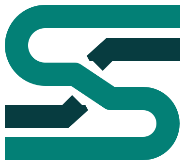

# Switchyard

A web UI for running a Caddy reverse proxy, replacing Nginx Proxy Manager.
Its manager (CPM, short for Caddy Proxy Manager) keeps hosts, certificates, folders and access rules in its own database
and builds **one complete Caddy JSON config** from it, sent through Caddy's
admin API. If Caddy rejects a config it keeps running the previous one, so
one bad host never takes down the rest.

Spec and decisions: Harbor Master wiki, `CaddyProxyManager/Design`.
Runbooks: `CaddyProxyManager/Operations` (and [docs/cutover.md](docs/cutover.md)).
Work tracking: Harbor Master project `CPM`.

## What it does

- **Hosts:** proxy, redirect and 404 hosts with several domains, http/https
  upstreams with load balancing and health checks, force HTTPS, HSTS,
  compression, custom request/response headers, rate limits, advanced raw
  Caddy routes (admins), clone.
- **Apply safely:** every change shows a diff against Caddy's running config
  first; every apply is a numbered version you can roll back to; drift
  (Caddy changed outside CPM) is detected every minute.
- **Certificates:** Let's Encrypt (HTTP challenge), Cloudflare DNS challenge
  for wildcard and internal names, or Caddy's internal CA. A certificates
  page shows expiry and Caddy's own error text, with "retry now".
- **Folders:** nested, drag-and-drop; folders pass access policies, a DNS
  provider, default headers and a rate limit down to their hosts.
- **Access control:** allow-only / deny policies by IP, CIDR or country
  (free DB-IP data, downloaded automatically; MaxMind GeoLite2 optional), a never-block list that overrides everything, bans, optional
  CrowdSec community block lists.
- **Dashboard:** traffic over time, bandwidth, error and blocked share,
  response times, top IPs / countries / paths / status codes / hosts, IP
  detail, live view.
- **Honeypot:** a catch-all for unknown hosts and bare IPs, trap paths on
  every host, scoring and automatic bans that reach every host in seconds.
- **Abuse bans:** addresses that keep getting rate-limited, blocked or
  not-found answers on real hosts are banned too (on by default: 30 / 50 /
  100 within 5 minutes; Honeypot page).
- **UniFi firewall sync (optional):** the ban list is kept in a UniFi
  gateway's firewall, so banned addresses are dropped before they reach
  Caddy. See [UniFi firewall](#unifi-firewall).
- **Admin:** users with admin / editor / viewer roles, TOTP two-factor
  sign-in (can be required), sign-in rate limits, audit log, alerts, health
  page, backup and restore, NPM importer.

## Install

On any machine with Docker and Docker Compose v2 (Linux, Unraid, macOS):

```bash
curl -fsSL https://raw.githubusercontent.com/encondata/switchyard/main/install.sh | bash
```

It asks where to install (`~/switchyard`, or `/mnt/user/appdata/switchyard`
on Unraid), makes the encryption key, picks free ports if 80, 443 or 8080
are taken (handy for testing next to Nginx Proxy Manager), builds and
starts everything, and prints the address and first sign-in. Run it again
to update; your settings and data are kept.

## UniFi firewall

Switchyard can keep its ban list in a UniFi gateway, so banned addresses are
dropped at the edge instead of reaching Caddy. It uses the official UniFi
Network Integration API, so it needs **UniFi Network 10 or newer**.

1. On the console: Settings → Control Plane → Integrations → create an API
   key. It acts as the admin who makes it, so use an admin with Network
   access.
2. In Switchyard: Honeypot → UniFi firewall. Enter the console's address
   (e.g. `https://192.168.1.1`) and the key, then **Check connection**.
   Consoles ship a self-signed certificate: compare the fingerprint with the
   one your browser shows for the console, then **Trust this certificate**.
   Switchyard then talks only to a console with that exact certificate, and
   never sends the key anywhere else.
3. Pick the site (a fabric can have several), tick **Keep the ban list in
   this console's firewall** and save. Switchyard creates an IP list called
   "Switchyard bans (IPv4)" (and an IPv6 one once there's an IPv6 ban).
4. On the console, once: add a zone-based firewall policy that **blocks**
   traffic from the External zone matching that list, to the zone your port
   forwards land in. The UniFi card confirms when it finds the policy.

The list follows the ban list within seconds of a change (even while Caddy
is down) and is checked every 5 minutes. Never-block addresses are never
banned, so they never reach the list. An empty ban list leaves one
placeholder entry (`192.0.2.255`, a documentation address that's never used
on the internet), because UniFi lists can't be empty.

## API

Other programs can manage Switchyard over its REST API with API keys that
admins make on **Administration → API keys**, each limited to the
operations you pick. See [docs/api.md](docs/api.md); the OpenAPI document
is at `/api/openapi.json`.

## Run it by hand

```bash
cp .env.example .env
echo "CPM_SECRET_KEY=$(openssl rand -base64 32)" >> .env   # keep a copy somewhere safe
docker compose up -d --build
```

- CPM UI: `http://<host>:8080`. Keep it on the LAN / VPN.
- Caddy: ports 80 and 443.
- First sign-in: **admin / 123456**. You must choose a new password first.

Optional extras:

```bash
docker compose --profile demo up -d    # a "whoami" test backend
docker compose --profile geoip up -d   # optional: MaxMind GeoLite2 instead of DB-IP (needs a MaxMind key in .env)
```

### Try it

1. Start with the demo backend (above).
2. **Hosts → Add host**: domain `app.localhost`, upstream `whoami` port `80`.
   Names ending in `.localhost` reach this machine without DNS, and Caddy
   gives them internal-CA certificates.
3. **Review & apply**, then open `https://app.localhost` (accept the
   certificate warning).
4. Look at the **Dashboard**; try an access policy on **Access**; turn on
   the **Honeypot** and request `http://app.localhost/.env`.

### Settings (environment)

| Variable | Default | What |
|---|---|---|
| `CPM_SECRET_KEY` | — | 32 random bytes, base64. Encrypts DNS tokens, the CrowdSec key and 2FA secrets. Needed for those features. |
| `CPM_LISTEN` | `0.0.0.0:8080` | CPM UI / API address |
| `CPM_DATA_DIR` | `./data` (`/data` in Docker) | `cpm.db` (config) and `hits.db` (traffic) |
| `CPM_SECURE_COOKIES` | `false` | Set `true` when CPM is served over HTTPS |
| `CPM_ACME_CA` | Caddy's default | ACME directory, e.g. Let's Encrypt staging |
| `CPM_ACME_EMAIL` | — | ACME account contact |
| `CPM_ACME_CA_ROOTS` | — | Extra CA roots for the ACME server (tests) |
| `CPM_HIT_RETENTION_DAYS` | `45` | How long raw traffic (with IPs) is kept |
| `GEOIPUPDATE_ACCOUNT_ID` / `GEOIPUPDATE_LICENSE_KEY` | — | Optional: MaxMind GeoLite2, used instead of the built-in DB-IP country data |
| `CPM_GEOIP_DOWNLOAD` | on | `off` stops CPM downloading DB-IP's free country database (monthly, from download.db-ip.com) |

The container paths (`CPM_CADDY_ADMIN_SOCKET`, `CPM_SECRETS_DIR`,
`CPM_CADDY_DATA_DIR`, log files, GeoIP path) are set in `compose.yaml`.

### How it runs

- Two containers, `caddy` (custom build, see below) and `cpm`, both as
  uid 1000. Caddy's admin API is only on a unix socket shared through a
  volume; port 2019 is never published.
- Caddy starts with the last config CPM applied (or `caddy/bootstrap.json`).
- Secrets (DNS tokens, CrowdSec key) are stored encrypted in `cpm.db` and
  handed to Caddy as files in the `cpm-secrets` volume; the config refers to
  them with `{file.…}`, so they never appear in config history or diffs.
- Caddy writes a JSON access log (no query strings or headers) that CPM
  ingests into `hits.db`: 45 days of raw hits (~220 bytes each, so about
  10 GB at 1M requests/day), 13 months of hourly totals without IPs.
- Backups (Health page) contain `cpm.db` only. Restoring needs the same
  `CPM_SECRET_KEY`.

## Custom Caddy image

`caddy/Dockerfile` builds Caddy with `xcaddy` from the pinned plugins in
`caddy/modules.txt` (Cloudflare DNS, MaxMind geolocation, rate limiting,
CrowdSec). The build fails if a listed plugin is missing from
`caddy list-modules`. CI publishes it as `ghcr.io/encondata/switchyard-caddy`
(amd64 + arm64).

## Develop

Requirements: Go (version in `go.mod`), Node 22, `golangci-lint` v2,
Docker.

```bash
make ui       # build the frontend into web/dist
make build    # build bin/cpm with the UI embedded
make run      # run the server on :8080
make test     # go test -race ./...
make lint     # golangci-lint, oxlint, prettier check, tsc
make fmt      # format Go and frontend code
make caddy    # build and check the Caddy image
tests/integration/run.sh   # end to end: Caddy + CPM + Pebble in Docker
```

For UI work with hot reload, run `make run` and `cd web && npm run dev`;
Vite proxies `/api` to `:8080`.

| Path | What |
|---|---|
| `cmd/cpm` | Server entry point |
| `internal/store` | SQLite database, migrations, validation, audit |
| `internal/compiler` | Database state → Caddy JSON (golden-file tests in `testdata/`) |
| `internal/apply` | Diff, apply, history, rollback, ban-list updates, secret files |
| `internal/caddyadmin` | Caddy admin API client (unix socket) |
| `internal/monitor` | Background checks: drift, Caddy, certificates, alerts |
| `internal/hits` | Access-log ingester, traffic database, dashboard queries |
| `internal/honeypot` | Scoring and automatic bans |
| `internal/npmimport` | Nginx Proxy Manager importer |
| `internal/server` | HTTP API and the embedded UI |
| `internal/{secrets,totp,ratelimit,geoip,certs,cloudflare}` | Supporting packages |
| `web` | React + TypeScript UI (Vite) |
| `caddy` | Custom Caddy image |
| `tests/integration` | End-to-end tests against real Caddy and Pebble |

CI runs on every push: frontend lint/build; Go lint, race tests, build and
smoke test; and the integration suite against real Caddy and Pebble.
Load test for the traffic database:
`CPM_LOADTEST=3000000 go test ./internal/hits -run TestLoad -v -timeout 30m`.
